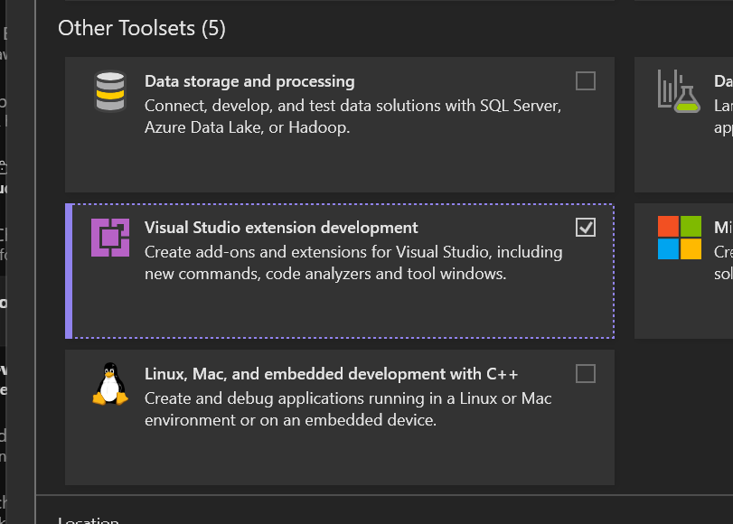

# Install the tools for Visual Studio extensibility

To develop Visual Studio extensions using VisualStudio.Extensibility, you need to install the **Visual Studio extension development** workload. This workload provides the project templates, SDK packages, and tools required for extension development.

For the best development experience, we recommend using Visual Studio 2026 version 18.11 or later, which includes the [Modern VSIX Project template](../ship/create-vsix-with-project-sdk.md). VisualStudio.Extensibility requires Visual Studio 2022 version 17.9 or higher as a minimum.

## Install the extension development workload

### During Visual Studio installation

When installing Visual Studio, select the **Visual Studio extension development** workload under **Other Toolsets**. This installs the VisualStudio.Extensibility SDK, project templates, and all necessary prerequisites.

### After Visual Studio is already installed

If Visual Studio is already installed, rerun the Visual Studio Installer and select the **Visual Studio extension development** workload:

1. Open the **Visual Studio Installer**.
2. Find your Visual Studio installation and select **Modify**.
3. Under **Other Toolsets**, select **Visual Studio extension development**.
4. Select **Modify** to apply the changes.

## Next steps

- [Create your first extension](create-your-first-extension.md)
- [Insert GUID sample ↗](https://github.com/microsoft/VSExtensibility/tree/main/New_Extensibility_Model/Samples/InsertGuid)
