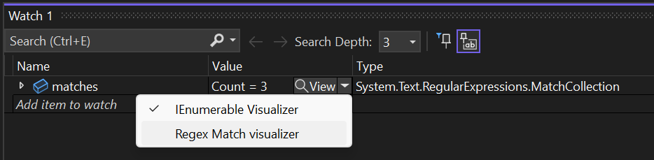

# Debugger visualizers

Debugger visualizers are a Visual Studio feature that provides a custom visualization for variables or objects of a specific .NET type during a debug session. Debugger visualizers are accessible from the *DataTip* that appears when hovering over a variable, or from the *Autos*, *Locals*, and *Watch* windows.

> [!NOTE]
> This article uses the **VisualStudio.Extensibility** SDK. For help choosing between **VisualStudio.Extensibility** and the legacy VSSDK, see [Choose the right extensibility model](../../how-it-works/models/extensibility-models.md).



## Full example

The complete implementation is in the sample:

:::code language="csharp" source="~/../vs-extensibility-samples/New_Extensibility_Model/Samples/RegexMatchDebugVisualizer/RegexMatchDebugVisualizer/RegexMatch/RegexMatchDebuggerVisualizerProvider.cs":::

> [!TIP]
> See the full working sample: [RegexMatchDebugVisualizer ↗](https://github.com/microsoft/VSExtensibility/tree/main/New_Extensibility_Model/Samples/RegexMatchDebugVisualizer/)

**Related concepts:** [Remote UI](../../how-it-works/remote-ui.md), [Contributions and configurations](../../how-it-works/contributions-and-configurations.md), and [Create your first extension](../../get-started/create-your-first-extension.md)

## Understand the example

### Get started

To get started, create a VisualStudio.Extensibility extension project by following [Create your first extension](../../get-started/create-your-first-extension.md).

Every extension starts with an `Extension` entry point that defines `ExtensionConfiguration` metadata:

```csharp
[VisualStudioContribution]
internal class MyExtension : Extension
{
    public override ExtensionConfiguration ExtensionConfiguration => new()
    {
        Metadata = new(
            id: "MyExtension.01234567",
            version: this.ExtensionAssemblyVersion,
            publisherName: "Contoso",
            displayName: "My debugger visualizer extension"),
    };
}
```

### Create the debugger visualizer provider

Add a class that extends [`DebuggerVisualizerProvider` ↗](/dotnet/api/microsoft.visualstudio.extensibility.debuggervisualizers.debuggervisualizerprovider) and apply the [`VisualStudioContribution` ↗](/dotnet/api/microsoft.visualstudio.extensibility.visualstudiocontributionattribute) attribute to it:

```csharp
[VisualStudioContribution]
internal class StringDebuggerVisualizerProvider : DebuggerVisualizerProvider
{
    public override DebuggerVisualizerProviderConfiguration DebuggerVisualizerProviderConfiguration => new(
        "My string visualizer",
        typeof(string));

    public override async Task<IRemoteUserControl> CreateVisualizerAsync(
        VisualizerTarget visualizerTarget,
        CancellationToken cancellationToken)
    {
        string targetObjectValue = await visualizerTarget.ObjectSource.RequestDataAsync<string>(
            jsonSerializer: null,
            cancellationToken);

        return new MyStringVisualizerControl(targetObjectValue);
    }
}
```

This code defines a new debugger visualizer for `string` values:

- `DebuggerVisualizerProviderConfiguration` defines the visualizer display name and supported .NET type.
- `CreateVisualizerAsync` is invoked when the user opens the visualizer. It uses [`VisualizerTarget` ↗](/dotnet/api/microsoft.visualstudio.extensibility.debuggervisualizers.visualizertarget) to retrieve data and returns a [Remote UI](../../how-it-works/remote-ui.md) control that Visual Studio shows in a popup window.

The same configuration object is where you declare details such as the target types, visualizer display names, `VisualizerObjectSourceType`, and whether the visualizer opens as a modal dialog or as a non-modal tool window.

### Target multiple types

The configuration property can target multiple types when it makes sense to share the same UI, view models, and visualizer object source. A common example is a tabular visualizer that supports `DataSet`, `DataTable`, `DataView`, and `DataViewManager`.

```csharp
public override DebuggerVisualizerProviderConfiguration DebuggerVisualizerProviderConfiguration => new(
    new VisualizerTargetType("DataSet Visualizer", typeof(System.Data.DataSet)),
    new VisualizerTargetType("DataTable Visualizer", typeof(System.Data.DataTable)),
    new VisualizerTargetType("DataView Visualizer", typeof(System.Data.DataView)),
    new VisualizerTargetType("DataViewManager Visualizer", typeof(System.Data.DataViewManager)));
```

### Work with the visualizer object source

The visualizer object source is a .NET class that the debugger loads into the process being debugged. Your debugger visualizer retrieves data from it through [`VisualizerTarget.ObjectSource` ↗](/dotnet/api/microsoft.visualstudio.extensibility.debuggervisualizers.visualizertarget.objectsource).

The default visualizer object source supports:

- [`RequestDataAsync<T>(JsonSerializer?, CancellationToken)` ↗](/dotnet/api/microsoft.visualstudio.extensibility.debuggervisualizers.visualizerobjectsourceclient.requestdataasync#microsoft-visualstudio-extensibility-debuggervisualizers-visualizerobjectsourceclient-requestdataasync-1(newtonsoft-json-jsonserializer-system-threading-cancellationtoken)) for strongly typed data
- [`RequestDataAsync(CancellationToken)` ↗](/dotnet/api/microsoft.visualstudio.extensibility.debuggervisualizers.visualizerobjectsourceclient.requestdataasync#microsoft-visualstudio-extensibility-debuggervisualizers-visualizerobjectsourceclient-requestdataasync(system-threading-cancellationtoken)) for `JToken`

The default implementation uses [Newtonsoft.Json ↗](https://www.nuget.org/packages/Newtonsoft.Json) for serialization. If the target type is already serializable, or if you can make your own type serializable, this default flow is often enough.

### Use a custom visualizer object source

If the type to be visualized can't be automatically serialized by Newtonsoft.Json, create a custom visualizer object source.

1. Create a new class library targeting `netstandard2.0`. If required, you can target a more specific framework such as `net472` or `net6.0`.
1. Add a package reference to [Microsoft.VisualStudio.DebuggerVisualizers ↗](https://www.nuget.org/packages/Microsoft.VisualStudio.DebuggerVisualizers) version 17.6 or later.
1. Create a class that extends [`VisualizerObjectSource` ↗](/dotnet/api/microsoft.visualstudio.extensibility.debuggervisualizers.visualizerobjectsourcetype) and override `GetData`.

```csharp
public class MyObjectSource : VisualizerObjectSource
{
    public override void GetData(object target, Stream outgoingData)
    {
        MySerializableType result = Convert(target);
        SerializeAsJson(outgoingData, result);
    }

    private static MySerializableType Convert(object target)
    {
        // Convert the debuggee object into a serializable type.
        throw new NotImplementedException();
    }
}
```

If you're following the Regex sample, `RegexMatchObjectSource` converts `Match` into a serializable `RegexMatch` shape before the provider requests it.

### Use custom serialization

Use `VisualizerObjectSource.SerializeAsJson` to serialize objects with Newtonsoft.Json without adding a direct Newtonsoft.Json dependency to the object-source library. The method loads the Newtonsoft.Json assembly in the debuggee process via reflection.

If you decide to reference Newtonsoft.Json directly, use the same version referenced by `Microsoft.VisualStudio.Extensibility.Sdk`. In most cases, it's better to use `DataContract` and `DataMember` attributes for shared types instead of relying on Newtonsoft.Json-specific types.

You can also implement your own serialization format and write directly to `outgoingData`.

### Add the visualizer object source DLL to the extension

Add a `ProjectReference` so the object-source project builds before the extension is packaged, and add a `Content` item so the DLL is copied into the extension output.

```xml
<ItemGroup>
  <Content Include="pathToTheObjectSourceDllBinPath\$(Configuration)\netstandard2.0\MyObjectSourceLibrary.dll"
           Link="netstandard2.0\MyObjectSourceLibrary.dll">
    <CopyToOutputDirectory>PreserveNewest</CopyToOutputDirectory>
  </Content>
</ItemGroup>

<ItemGroup>
  <ProjectReference Include="..\MyObjectSourceLibrary\MyObjectSourceLibrary.csproj" />
</ItemGroup>
```

You can also use `net462` or `netcoreapp` subfolders if the object-source library targets those frameworks, but `netstandard2.0` is preferred when possible.

Keep the object-source library's dependency graph as small as possible. If it depends on other DLLs that the debuggee doesn't already load, include those DLLs in the same extension subfolder.

### Configure the provider to use the custom object source

After the object-source DLL is packaged, update `DebuggerVisualizerProviderConfiguration` to point to it:

```csharp
public override DebuggerVisualizerProviderConfiguration DebuggerVisualizerProviderConfiguration => new(
    "My visualizer",
    typeof(TypeToVisualize))
{
    VisualizerObjectSourceType = new(typeof(MyObjectSource)),
};
```

```csharp
public override async Task<IRemoteUserControl> CreateVisualizerAsync(
    VisualizerTarget visualizerTarget,
    CancellationToken cancellationToken)
{
    MySerializableType result = await visualizerTarget.ObjectSource.RequestDataAsync<MySerializableType>(
        jsonSerializer: null,
        cancellationToken);

    return new MyVisualizerUserControl(result);
}
```

If you intentionally avoid an assembly reference from the extension to the object-source project, configure `VisualizerObjectSourceType` with the assembly-qualified name instead of `typeof(...)`. The Regex sample uses that pattern.

### Work with large and complex objects

If retrieving all data in one parameterless `RequestDataAsync` call isn't practical, use [`RequestDataAsync<TMessage, TResponse>(TMessage, JsonSerializer?, CancellationToken)` ↗](/dotnet/api/microsoft.visualstudio.extensibility.debuggervisualizers.visualizerobjectsourceclient.requestdataasync#microsoft-visualstudio-extensibility-debuggervisualizers-visualizerobjectsourceclient-requestdataasync-2(-0-newtonsoft-json-jsonserializer-system-threading-cancellationtoken)) to exchange messages with the object source.

This pattern is useful for large collections because each `RequestDataAsync` call has a five-second timeout. A common approach is to request entries one at a time:

```csharp
for (int i = 0; ; i++)
{
    MySerializableType? collectionEntry =
        await visualizerTarget.ObjectSource.RequestDataAsync<int, MySerializableType?>(
            i,
            jsonSerializer: null,
            cancellationToken);

    if (collectionEntry is null)
    {
        break;
    }

    observableCollection.Add(collectionEntry);
}
```

On the object-source side, override `TransferData` instead of `GetData`:

```csharp
public class MyCollectionTypeObjectSource : VisualizerObjectSource
{
    public override void TransferData(object target, Stream incomingData, Stream outgoingData)
    {
        var index = (int)DeserializeFromJson(incomingData, typeof(int))!;

        if (target is MyCollectionType collection && index < collection.Count)
        {
            var result = Convert(collection[index]);
            SerializeAsJson(outgoingData, result);
        }
        else
        {
            SerializeAsJson(outgoingData, null);
        }
    }
}
```

`DeserializeFromJson` reads the message that the provider sent through `incomingData`.

When a visualizer performs more complex message exchanges, it's often better to pass the [`VisualizerTarget` ↗](/dotnet/api/microsoft.visualstudio.extensibility.debuggervisualizers.visualizertarget) to the remote user control so it can request data asynchronously while the control is loading, or later in response to user interaction:

```csharp
public override Task<IRemoteUserControl> CreateVisualizerAsync(
    VisualizerTarget visualizerTarget,
    CancellationToken cancellationToken)
{
    return Task.FromResult<IRemoteUserControl>(new MyVisualizerUserControl(visualizerTarget));
}
```

### Open visualizers as tool windows

By default, debugger visualizers open as modal dialogs in the foreground of Visual Studio. If the user wants to continue interacting with the IDE, they must close the modal visualizer first.

If you set `Style = VisualizerStyle.ToolWindow`, the visualizer opens as a non-modal tool window and can remain open for the rest of the debug session. If you don't set `Style`, the default is `ModalDialog`.

```csharp
public override DebuggerVisualizerProviderConfiguration DebuggerVisualizerProviderConfiguration => new(
    "My visualizer",
    typeof(TypeToVisualize))
{
    Style = VisualizerStyle.ToolWindow
};
```

When a visualizer opens as a tool window, it must subscribe to the `VisualizerTarget.Changed` event. Tool windows don't block the user from resuming execution, so the debugger raises notifications whenever the debug target changes state. When the target isn't available, calls to `ObjectSource` fail with `VisualizerTargetUnavailableException`.

```csharp
internal class MyVisualizerUserControl : RemoteUserControl
{
    private readonly VisualizerDataContext dataContext;

#pragma warning disable CA2000 // Dispose objects before losing scope
    public MyVisualizerUserControl(VisualizerTarget visualizerTarget)
        : base(dataContext: new VisualizerDataContext(visualizerTarget))
#pragma warning restore CA2000 // Dispose objects before losing scope
    {
        this.dataContext = (VisualizerDataContext)this.DataContext!;
    }

    protected override void Dispose(bool disposing)
    {
        if (disposing)
        {
            this.dataContext.Dispose();
        }
    }

    [DataContract]
    private class VisualizerDataContext : NotifyPropertyChangedObject, IDisposable
    {
        private readonly VisualizerTarget visualizerTarget;
        private MySerializableType? _value;

        public VisualizerDataContext(VisualizerTarget visualizerTarget)
        {
            this.visualizerTarget = visualizerTarget;
            this.visualizerTarget.Changed += this.OnStateChangedAsync;
        }

        [DataMember]
        public MySerializableType? Value
        {
            get => this._value;
            set => this.SetProperty(ref this._value, value);
        }

        public void Dispose()
        {
            this.visualizerTarget.Dispose();
        }

        private async Task OnStateChangedAsync(object? sender, VisualizerTargetStateNotification args)
        {
            switch (args)
            {
                case VisualizerTargetStateNotification.Available:
                case VisualizerTargetStateNotification.ValueUpdated:
                    Value = await this.visualizerTarget.ObjectSource.RequestDataAsync<MySerializableType>(
                        jsonSerializer: null,
                        CancellationToken.None);
                    break;
                case VisualizerTargetStateNotification.Unavailable:
                    Value = null;
                    break;
                default:
                    throw new NotSupportedException("Unexpected visualizer target state notification");
            }
        }
    }
}
```

`Available` is raised after the `RemoteUserControl` is created and just before Visual Studio shows the tool window. `ValueUpdated` indicates that the expression was successfully re-evaluated at the current break state and the UI should refresh. `Unavailable` indicates that execution resumed or that the expression couldn't be re-evaluated after execution stopped.

### Update the visualized object value

If [`VisualizerTarget.IsTargetReplaceable` ↗](/dotnet/api/microsoft.visualstudio.extensibility.debuggervisualizers.visualizertarget.istargetreplaceable) is `true`, the visualizer can update the debuggee value by calling [`ReplaceTargetObjectAsync` ↗](/dotnet/api/microsoft.visualstudio.extensibility.debuggervisualizers.visualizerobjectsourceclient.replacetargetobjectasync#microsoft-visualstudio-extensibility-debuggervisualizers-visualizerobjectsourceclient-replacetargetobjectasync-1(-0-newtonsoft-json-jsonserializer-system-threading-cancellationtoken)).

```csharp
await visualizerTarget.ObjectSource.ReplaceTargetObjectAsync(
    newValue,
    jsonSerializer: null,
    cancellationToken);
```

The visualizer object source must override `CreateReplacementObject`:

```csharp
public override object CreateReplacementObject(object target, Stream incomingData)
{
    // Read the replacement value from incomingData.
    return newValue;
}
```

## Tips

### ✅ DO

- Put extension metadata in `ExtensionConfiguration` and contribution settings in `DebuggerVisualizerProviderConfiguration`.
- Use `netstandard2.0` for the object-source project unless you have a specific reason to target another framework.
- Use `DataContract` and `DataMember` on shared data types.
- Package the object-source DLL and any required dependencies with the extension.
- Use paged `RequestDataAsync` calls for large or expensive objects.
- Handle `VisualizerTarget.Changed` when opening as a tool window.

### ❌ DON'T

- Don't reference VisualStudio.Extensibility packages from the object-source project.
- Don't assume every type can be serialized by the default object source.
- Don't leave a tool-window visualizer unaware of `Unavailable` notifications.
- Don't forget that `RequestDataAsync` calls can time out after five seconds.

### 🔧 Troubleshooting

| Symptom | What to check |
|---|---|
| Visualizer doesn't appear | Verify the provider class has `[VisualStudioContribution]` and that `DebuggerVisualizerProviderConfiguration` targets the correct .NET type. |
| `RequestDataAsync` fails or times out | Move large data retrieval to `TransferData` and page the data across multiple calls. |
| Custom object source isn't found | Confirm the DLL is copied into the extension's `netstandard2.0` folder and `VisualizerObjectSourceType` points to the correct type or assembly-qualified name. |
| Tool-window visualizer throws when debugging continues | Handle `VisualizerTargetStateNotification.Unavailable` and avoid `ObjectSource` calls until the target is available again. |

## Next steps

- Explore the full [RegexMatchDebugVisualizer sample ↗](https://github.com/microsoft/VSExtensibility/tree/main/New_Extensibility_Model/Samples/RegexMatchDebugVisualizer/).
- Learn more about [Remote UI](../../how-it-works/remote-ui.md).
- Review [Contributions and configurations](../../how-it-works/contributions-and-configurations.md).
- Compare models in [Choose the right extensibility model](../../how-it-works/models/extensibility-models.md).
