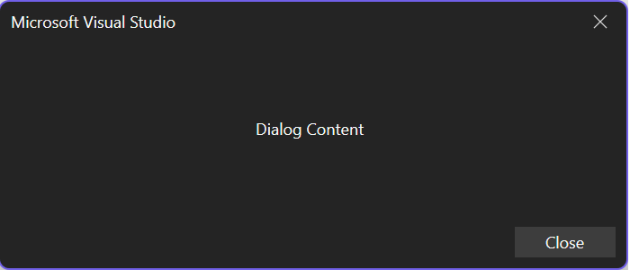
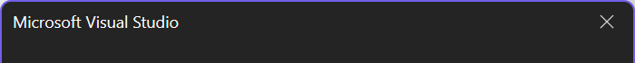
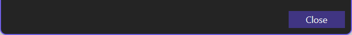

# Dialogs

Dialogs are a way to prompt users for information or let them customize feature behavior. In VisualStudio.Extensibility, you show dialogs by passing [Remote UI](../../how-it-works/remote-ui.md) content to `ShowDialogAsync`.

> [!NOTE]
> This article uses the **VisualStudio.Extensibility** SDK. For help choosing between **VisualStudio.Extensibility** and the legacy VSSDK, see [Choose the right extensibility model](../../how-it-works/models/extensibility-models.md).

## Full example

The complete implementation is in the sample:

:::code language="csharp" source="~/../vs-extensibility-samples/New_Extensibility_Model/Samples/DialogSample/MyDialogCommand.cs":::

> [!TIP]
> See the full working sample: [DialogSample ↗](https://github.com/microsoft/VSExtensibility/tree/main/New_Extensibility_Model/Samples/DialogSample/)

**Related concepts:** [Remote UI](../../how-it-works/remote-ui.md), [User prompts](./user-prompts.md), and [Create your first extension](../../get-started/create-your-first-extension.md)

## Understand the example



### Get started

To get started, create a VisualStudio.Extensibility extension by following [Create your first extension](../../get-started/create-your-first-extension.md).

This article covers the main dialog scenarios:

- Create a dialog
- Customize the dialog title
- Customize the dialog buttons
- Get the dialog result

### Create a dialog

Creating a dialog is as simple as calling [`ShowDialogAsync` ↗](/dotnet/api/microsoft.visualstudio.extensibility.shell.shellextensibility.showdialogasync) from [`ShellExtensibility` ↗](/dotnet/api/microsoft.visualstudio.extensibility.shell.shellextensibility) and passing in your dialog content.

```csharp
public override async Task ExecuteCommandAsync(IClientContext context, CancellationToken cancellationToken)
{
    // Ownership of the RemoteUserControl is transferred to Visual Studio,
    // so it shouldn't be disposed by the extension.
#pragma warning disable CA2000 // Dispose objects before losing scope
    var control = new MyDialogControl(null);
#pragma warning restore CA2000 // Dispose objects before losing scope

    await this.Extensibility.Shell().ShowDialogAsync(control, cancellationToken);
}
```

### Create dialog content with Remote UI

Dialog content is a [Remote UI](../../how-it-works/remote-ui.md) control. The dialog sample creates a `RemoteUserControl` and loads an embedded resource dictionary:

```csharp
internal class MyDialogControl : RemoteUserControl
{
    public MyDialogControl(object? dataContext, SynchronizationContext? synchronizationContext = null)
        : base(dataContext, synchronizationContext)
    {
        this.ResourceDictionaries.AddEmbeddedResource("DialogSample.Resources.MyResources.xaml");
    }
}
```

The associated XAML defines the dialog's visible content:

```xaml
<DataTemplate xmlns="http://schemas.microsoft.com/winfx/2006/xaml/presentation"
              xmlns:x="http://schemas.microsoft.com/winfx/2006/xaml"
              xmlns:vs="http://schemas.microsoft.com/visualstudio/extensibility/2022/xaml">
  <Border Padding="5">
    <TextBlock Margin="0,0,5,0"
               Text="{DynamicResource myDialogText}" />
  </Border>
</DataTemplate>
```

For more information on building the UI itself, see [Remote UI](../../how-it-works/remote-ui.md).

### Understand `ShowDialogAsync`

`ShowDialogAsync` has several overloads:

- [`ShowDialogAsync(content,cancellationToken)` ↗](/dotnet/api/microsoft.visualstudio.extensibility.shell.shellextensibility.showdialogasync#microsoft-visualstudio-extensibility-shell-shellextensibility-showdialogasync(microsoft-visualstudio-rpccontracts-remoteui-iremoteusercontrol-system-threading-cancellationtoken))
- [`ShowDialogAsync(content,title,cancellationToken)` ↗](/dotnet/api/microsoft.visualstudio.extensibility.shell.shellextensibility.showdialogasync#microsoft-visualstudio-extensibility-shell-shellextensibility-showdialogasync(microsoft-visualstudio-rpccontracts-remoteui-iremoteusercontrol-system-string-system-threading-cancellationtoken))
- [`ShowDialogAsync(content,options,cancellationToken)` ↗](/dotnet/api/microsoft.visualstudio.extensibility.shell.shellextensibility.showdialogasync#microsoft-visualstudio-extensibility-shell-shellextensibility-showdialogasync(microsoft-visualstudio-rpccontracts-remoteui-iremoteusercontrol-microsoft-visualstudio-rpccontracts-notifications-dialogoption-system-threading-cancellationtoken))
- [`ShowDialogAsync(content,title,options,cancellationToken)` ↗](/dotnet/api/microsoft.visualstudio.extensibility.shell.shellextensibility.showdialogasync#microsoft-visualstudio-extensibility-shell-shellextensibility-showdialogasync(microsoft-visualstudio-rpccontracts-remoteui-iremoteusercontrol-system-string-microsoft-visualstudio-rpccontracts-notifications-dialogoption-system-threading-cancellationtoken))

The key parameters are:

| Parameter | Type | Description |
|---|---|---|
| `content` | [IRemoteUserControl ↗](/dotnet/api/microsoft.visualstudio.rpccontracts.remoteui.iremoteusercontrol) | The Remote UI content shown in the dialog. |
| `title` | [string ↗](/dotnet/api/system.string) | The dialog title shown in the caption area. |
| `options` | `Microsoft.VisualStudio.RpcContracts.Notifications.DialogOption` | The dialog button set and default action. |
| `cancellationToken` | [CancellationToken ↗](/dotnet/api/system.threading.cancellationtoken) | Cancels the dialog. |

### Customize the dialog title

When your extension shows a dialog, you can provide a custom title string to display in the dialog caption.



```csharp
public override async Task ExecuteCommandAsync(IClientContext context, CancellationToken cancellationToken)
{
#pragma warning disable CA2000 // Dispose objects before losing scope
    var control = new MyDialogControl(null);
#pragma warning restore CA2000 // Dispose objects before losing scope

    await this.Extensibility.Shell().ShowDialogAsync(
        control,
        "My Dialog Title",
        cancellationToken);
}
```

### Customize the dialog buttons

When Visual Studio shows a dialog, you can choose predefined button combinations and default actions through `Microsoft.VisualStudio.RpcContracts.Notifications.DialogOption`.



You can use predefined combinations such as:

- `DialogOption.Close`
- `DialogOption.OK`
- `DialogOption.OKCancel`

You can also create your own combination by using `DialogButton` with a default `DialogResult`.

Available `DialogButton` values:

```csharp
public enum DialogButton
{
    None,
    Close,
    OK,
    OKCancel
}
```

Available `DialogResult` values:

```csharp
public enum DialogResult
{
    None,
    Close,
    OK,
    Cancel
}
```

#### Button examples

Show a single **Close** button:

```csharp
await this.Extensibility.Shell().ShowDialogAsync(
    control,
    DialogOption.Close,
    cancellationToken);
```

Add **OK** and **Cancel** buttons:

```csharp
public override async Task ExecuteCommandAsync(IClientContext context, CancellationToken cancellationToken)
{
#pragma warning disable CA2000 // Dispose objects before losing scope
    var control = new MyDialogControl(null);
#pragma warning restore CA2000 // Dispose objects before losing scope

    await this.Extensibility.Shell().ShowDialogAsync(
        control,
        DialogOption.OKCancel,
        cancellationToken);
}
```

Show no dialog buttons:

```csharp
public override async Task ExecuteCommandAsync(IClientContext context, CancellationToken cancellationToken)
{
#pragma warning disable CA2000 // Dispose objects before losing scope
    var control = new MyDialogControl(null);
#pragma warning restore CA2000 // Dispose objects before losing scope

    await this.Extensibility.Shell().ShowDialogAsync(
        control,
        new DialogOption(DialogButton.None, DialogResult.None),
        cancellationToken);
}
```

### Get the dialog return value

If you need to know how the user dismissed the dialog, await `ShowDialogAsync`. It returns `Microsoft.VisualStudio.RpcContracts.Notifications.DialogResult`.

```csharp
public override async Task ExecuteCommandAsync(IClientContext context, CancellationToken cancellationToken)
{
#pragma warning disable CA2000 // Dispose objects before losing scope
    var control = new MyDialogControl(null);
#pragma warning restore CA2000 // Dispose objects before losing scope

    DialogResult result = await this.Extensibility.Shell().ShowDialogAsync(
        control,
        "My Dialog Title",
        DialogOption.OKCancel,
        cancellationToken);

    if (result == DialogResult.OK)
    {
        // The user pressed the OK button.
    }
}
```

## Tips

### ✅ DO

- Create dialog content with `RemoteUserControl`.
- Await `ShowDialogAsync` when you need the dialog return value.
- Use a custom title when the dialog needs more context than the command name provides.
- Choose predefined `DialogOption` values when they match your scenario.

### ❌ DON'T

- Don't dispose the `RemoteUserControl` after passing it to `ShowDialogAsync`; ownership transfers to Visual Studio.
- Don't use a full custom dialog when a simpler [user prompt](./user-prompts.md) is enough.
- Don't forget to pass a `CancellationToken` if the dialog can be canceled by extension logic.

### 🔧 Troubleshooting

| Symptom | What to check |
|---|---|
| Dialog doesn't appear | Make sure your command has access to `this.Extensibility.Shell()` and that the command is being invoked. |
| Dialog content is blank | Verify that the `RemoteUserControl` loads its embedded XAML resources correctly. |
| Wrong buttons appear | Check whether you're using a predefined `DialogOption` or a custom `new DialogOption(DialogButton, DialogResult)` value. |
| You can't tell how the dialog closed | Await `ShowDialogAsync` and inspect the returned `DialogResult`. |

## Next steps

- Explore the full [DialogSample ↗](https://github.com/microsoft/VSExtensibility/tree/main/New_Extensibility_Model/Samples/DialogSample/).
- Learn more about [Remote UI](../../how-it-works/remote-ui.md).
- Use [User prompts](./user-prompts.md) for simpler confirmation flows.
- Start from [Create your first extension](../../get-started/create-your-first-extension.md) if you need a project scaffold.
