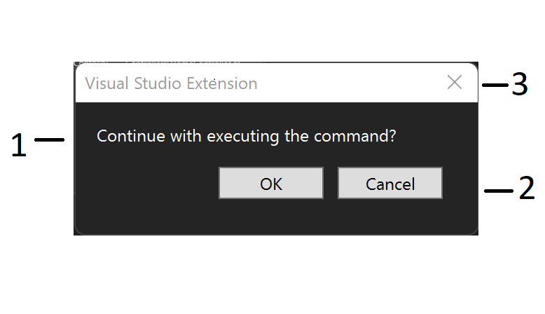

# User prompts

Show confirmation dialogs, custom choice prompts, and text input prompts from your extension using `ShowPromptAsync`.

> [!NOTE]
> This guide uses the **VisualStudio.Extensibility** SDK. See [Choose the right extensibility model](../../how-it-works/models/extensibility-models.md) for model comparison.

## Full example

The complete implementation:

:::code language="csharp" source="~/../vs-extensibility-samples/New_Extensibility_Model/Samples/UserPromptSample/SampleCommand.cs":::

> [!TIP]
> See the full working sample: [UserPromptSample ↗](https://github.com/Microsoft/VSExtensibility/tree/main/New_Extensibility_Model/Samples/UserPromptSample/)

**Related concepts:** [Remote UI](../../how-it-works/remote-ui.md) — the data-binding model used for prompt UI

## Understand the example

### Parts of a user prompt



1. Message
2. Choice buttons
3. Close button

### Simple confirmation (OK/Cancel)

```csharp
public override async Task ExecuteCommandAsync(IClientContext context, CancellationToken ct)
{
    bool confirmed = await this.Extensibility.Shell().ShowPromptAsync(
        "Are you sure you want to continue?",
        PromptOptions.OKCancel,
        ct);

    if (!confirmed)
    {
        return;
    }

    // Proceed with the operation...
}
```

Returns `true` for **OK**, `false` for **Cancel** or the **Close** button.

### Use `WithCancelAsDefault` for destructive operations

When a prompt guards a destructive action, make **Cancel** the default so that pressing Enter doesn't accidentally confirm:

```csharp
bool confirmed = await this.Extensibility.Shell().ShowPromptAsync(
    "Delete all generated files? This cannot be undone.",
    PromptOptions.OKCancel.WithCancelAsDefault(),
    ct);
```

### Custom options with an enum

Define an enum for your choices, then map labels to values with `PromptOptions<T>`:

```csharp
public enum SaveChoice
{
    Save,
    Discard,
    Cancel,
}
```

```csharp
SaveChoice result = await this.Extensibility.Shell().ShowPromptAsync(
    "You have unsaved changes.",
    new PromptOptions<SaveChoice>
    {
        Choices =
        {
            { "Save", SaveChoice.Save },
            { "Discard", SaveChoice.Discard },
            { "Cancel", SaveChoice.Cancel },
        },
        DismissedReturns = SaveChoice.Cancel,
        DefaultChoiceIndex = 0,
    },
    ct);

switch (result)
{
    case SaveChoice.Save:
        await SaveDocumentAsync();
        break;
    case SaveChoice.Discard:
        RevertChanges();
        break;
    case SaveChoice.Cancel:
        return;
}
```

- `DismissedReturns` — value returned when the user closes with the **X** button or presses Escape.
- `DefaultChoiceIndex` — zero-based index of the button that has initial focus.

### Customize icon and title

```csharp
var result = await this.Extensibility.Shell().ShowPromptAsync(
    "Select the system to configure:",
    new PromptOptions<Systems>
    {
        Choices =
        {
            { "Core", Systems.CoreSystem },
            { "Auxiliary", Systems.AuxiliarySystem },
            { "Monitoring", Systems.MonitoringSystem },
        },
        DismissedReturns = Systems.CoreSystem,
        DefaultChoiceIndex = 2,
        Title = "Configuration Assistant",
        Icon = ImageMoniker.KnownValues.Settings,
    },
    ct);
```

### Text input prompt

Use `InputPromptOptions` to collect a single-line string from the user:

```csharp
string? name = await this.Extensibility.Shell().ShowPromptAsync(
    "Enter project name:",
    InputPromptOptions.Default,
    ct);

if (name is null)
{
    // User dismissed without entering a value
    return;
}

// Use the value (may be empty string if user confirmed blank input)
await CreateProjectAsync(name);
```

Set a default value or customize the title:

```csharp
string? name = await this.Extensibility.Shell().ShowPromptAsync(
    "Enter project name:",
    InputPromptOptions.Default with
    {
        DefaultText = "MyProject",
        Title = "New Project",
    },
    ct);
```

Input prompt return values:

| User action | Return value |
|---|---|
| Enters text and selects **OK** | The entered string |
| Leaves blank and selects **OK** | Empty string (`""`) |
| Selects **Cancel**, **X**, or Escape | `null` |

### Validate text input

Set `Validation` to check the input against a regular expression. For checks that require asynchronous work, add a `ValidationCallback` that returns an error message when the input is invalid or `null` when it's valid:

```csharp
string? projectName = await this.Extensibility.Shell().ShowPromptAsync(
    "Enter project name:",
    InputPromptOptions.Default with
    {
        Validation = new InputValidation(
            @"^[A-Za-z][A-Za-z0-9_-]*$",
            "Start with a letter; use only letters, numbers, hyphens, or underscores."),
        ValidationCallback = async (input, token) =>
        {
            // Simulate an asynchronous check without an external service.
            await Task.Delay(150, token);
            return string.Equals(input, "CON", StringComparison.OrdinalIgnoreCase)
                ? "CON is a reserved Windows name; choose another project name."
                : null;
        },
    },
    ct);

if (projectName is null)
{
    return; // User dismissed the prompt.
}

await CreateProjectAsync(projectName);
```

For example, `123project` fails the regex, `CON` fails the callback, and `MyProject` passes both checks. The SDK checks the regex before invoking the debounced callback, so the callback doesn't run for input that fails the regex. Pass the callback's cancellation token to asynchronous work: validation can be canceled when it is no longer needed. While input is invalid, the prompt displays the corresponding error and disables **OK**. Dismissing the prompt still returns `null`, not an empty string. See the [UserPromptSample advanced configuration command ↗](https://github.com/microsoft/VSExtensibility/blob/main/New_Extensibility_Model/Samples/UserPromptSample/AdvancedConfigurationCommand.cs) for the working example.

### Built-in `PromptOptions` reference

| Option | Buttons | Returns |
|---|---|---|
| `PromptOptions.OK` | OK | `true` / `false` (dismissed) |
| `PromptOptions.OKCancel` | OK, Cancel | `true` / `false` |
| `PromptOptions.RetryCancel` | Retry, Cancel | `true` / `false` |

Icon variants for single-button confirmations:

| Option | Icon |
|---|---|
| `PromptOptions.ErrorConfirm` | `StatusError` |
| `PromptOptions.WarningConfirm` | `StatusWarning` |
| `PromptOptions.AlertConfirm` | `StatusAlert` |
| `PromptOptions.InformationConfirm` | `StatusInformation` |
| `PromptOptions.HelpConfirm` | `StatusConfirm` |

## Tips

### ✅ DO

- Use `PromptOptions.OKCancel` for simple confirmations.
- Use `WithCancelAsDefault()` for destructive operations to prevent accidental confirmation.
- Always set `DismissedReturns` to handle the **X** button and Escape gracefully.
- Check for `null` return from input prompts (user cancelled).
- Use descriptive prompt messages that explain the consequence of each option.

### ❌ DON'T

- Don't use more than 3 custom options — use a [dialog](dialogs.md) for complex choices.
- Don't forget to handle the dismissed case (**X** button, Escape key).
- Don't use prompts to display information only — use the Output window or status bar instead.

### 🔧 Troubleshooting

| Symptom | Fix |
|---------|-----|
| Prompt doesn't appear | Ensure command is executing — prompts require an active execution context. |
| Wrong button selected by default | Set `DefaultChoiceIndex` explicitly. |
| `NullReferenceException` after input prompt | Check for `null` return — user dismissed without entering a value. |

## Next steps

- [Dialogs](dialogs.md) — complex multi-field UI
- [File pickers](file-directory-pickers.md) — file and folder selection
- [Add a command](../commands/commands.md) — trigger prompts from commands
