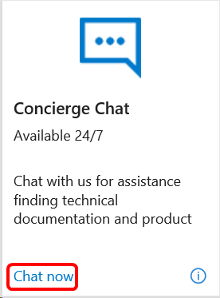

# Concierge Chat in Visual Studio subscriptions

The Concierge Chat service helps you find product information, technical documentation, and guidance on using your Visual Studio subscription benefits.

The service is available 24/7 and is currently offered in English only. 

## Activation steps

Getting help via the Concierge Chat service is easy.

1. Sign in to [My Visual Studio](https://my.visualstudio.com/benefits?wt.mc_id=o~msft~docs) and then go to **Benefits**.

2. Locate the Concierge Chat tile in the Support section of the benefits page and select **Chat now**.
    > [!div class="mx-imgBorder"]
    > 

3. A blue chat box appears in the bottom right corner.

4. A VSS Support chat opens, and an agent is assigned to assist you.

5. When an agent is available, the chat starts.
   
## Eligibility

| Subscription Level | Channels | Benefit | Renewable? |
| ------------------ | -------- | ------- | ---------- |
| Visual Studio Enterprise (Standard) | VL, Azure, Retail,  selected NFR\* | Available | Yes |
| Visual Studio Enterprise subscription with GitHub Enterprise | VL | Available | Yes |
| Visual Studio Professional (Standard) | VL, Azure, Retail | Available | Yes |
| Visual Studio Professional subscription with GitHub Enterprise | VL | Available | Yes |
| Visual Studio Test Professional (Standard) | VL, Retail | Available | Yes |
| MSDN Platforms (Standard) | VL, Retail | Available | Yes |
| Visual Studio Enterprise (monthly cloud), Visual Studio Professional (monthly cloud) | Azure | Not available | N/A |

\*  *Includes:  Not for Resale (NFR), Visual Studio Industry Partner (VSIP), Microsoft Certified Trainer, Microsoft AI Cloud Partner Program (MAICPP), We Comms, Open Source Heroes, Microsoft Bug Bounty, Independent Software Vendor (ISV), Most Valuable Professional, and Regional Directors (MVP/RD).*

\*  *Excludes: Microsoft Full Time Employee (FTE), Microsoft Partner Network (MPN), Microsoft Cloud Partner Program (MCPP), Azure Dev Tools for Teaching (ADT4T), Student Ambassadors, Microsoft for Startups, NFR Basic (Alumni, Xbox).*

> [!NOTE]

Not sure which subscription you're using? Connect to [https://my.visualstudio.com/subscriptions](https://my.visualstudio.com/subscriptions?wt.mc_id=o~msft~docs) to see all the subscriptions assigned to your email address. If you don't see all your subscriptions, you might have one or more assigned to a different email address. You need to sign in with that email address to see those subscriptions.

## Frequently asked questions

### Q:  Is the chat service available in multiple languages?

   A: Assistance with locating product information and technical documentation is available in English only.

## Support resources

+ For assistance with sales, subscriptions, accounts, and billing for Visual Studio Subscriptions, contact [Visual Studio subscriptions support](https://my.visualstudio.com/gethelp).

+ Have a question about Visual Studio IDE, Azure DevOps Services, or other Visual Studio products or services? Visit [Visual Studio Support](https://visualstudio.microsoft.com/support/).

## See also

+ [Visual Studio documentation](/visualstudio/)

